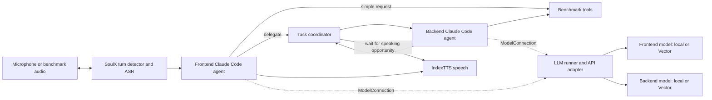

# SoulX Audio Agent

A new implementation of the **Frontend Agent → Orchestration Runtime → Backend Agent**
structure from the [Qwen-Audio-Agent technical report](https://arxiv.org/abs/2609.25195).
The [SoulX-Duplug dialogue-system branch](https://github.com/Soul-AILab/SoulX-Duplug/tree/dialogue-system)
provides the browser frontend, streaming turn detector and ASR; its IndexTTS service
speaks the replies. Both text agents execute through the **Claude Agent SDK / Claude Code harness**.
**The frontend now defaults to an SGLang-Omni session graph.** Its custom CPU stage
owns the existing SoulX perception, speech and conversation lifecycle, including the
Claude Code agents. The compatibility gateway preserves benchmark-owned tool calls
and reconnect behavior. This is a custom external-service graph; it does not select
Omni's bundled Qwen3-ASR/Qwen3-TTS model profile. The default Qwen3.5-4B text engine runs
in an independent SGLang service; the vLLM runner remains selectable.

**Agent execution and LLM serving are separate layers.** Claude Code handles the
agent loop, tools and context. The LLM runner owns model endpoints, credentials,
optional server processes and API adaptation. Frontend and backend can independently
use Vector or a local OpenAI-compatible LLM server while keeping the same harness.

The inference jobs default to `config/llm/qwen35_4b_sglang_vector.yaml`: a local SGLang
`Qwen/Qwen3.5-4B` frontend with thinking disabled, and Vector's `Qwen3_8-27B` backend.
The Vector endpoint/key convention follows NewCastle's `UserSimulation-CS`.
`config/llm.yaml` retains a selectable all-Vector configuration. Neither the harness
nor orchestration depends on Vector.



## What is implemented

- The frontend decides whether to answer, call an environment tool, or submit background work.
- Delegation returns immediately. Later user turns can proceed while backend work runs.
- Barge-in cancels speech playback without cancelling accepted backend tasks.
- Completed backend replies wait while the user speaks or the frontend handles a turn.
- Explicit task inspection/cancellation tools and a per-session event journal are provided.
- Browser refresh and realtime transport reconnect can reattach to an in-memory session.
- Benchmark tools execute inside the benchmark's own environment. Neither agent receives
  unrestricted shell/filesystem tools during evaluation.
- Source revisions and runtime fingerprints are checked on resume. Changed audio/configuration
  is rejected rather than silently combined with old results.

The paper is the architectural reference. This project does not reproduce its complete
memory system, permission UI, desktop integrations, or reported experiments. The journal
is an audit trail; it does not restore tasks after a server/process restart. Speech
`emitted` events record server transmission, not confirmed listener playback.

## Layout

| Path | Responsibility |
| --- | --- |
| `soulx_agent/harness.py` | Claude Code SDK execution and MCP tools; accepts a `ModelConnection` |
| `soulx_agent/application.py`, `contracts.py` | Wire role aliases to the harness through small shared contracts |
| `soulx_agent/llm_runner.py`, `scripts/run_llm.py` | Model endpoint selection, credentials, readiness, optional local serving and API adaptation |
| `soulx_agent/orchestration.py` | Foreground turns, independent backend tasks and result delivery |
| `soulx_agent/audio.py` | SoulX float32/16 kHz protocol and IndexTTS client |
| `soulx_agent/server.py` | Browser and realtime audio gateway; PCM16/24 kHz benchmark endpoint |
| `soulx_agent/benchmarks/` | tau-Voice, EVA and FDB v3 adapters |
| `web/` | SoulX browser frontend, with tab session persistence |
| `scripts/` | Source setup, service supervision, inference and evaluation |
| `jobs/inference/`, `jobs/eval/` | Three benchmark jobs each; nothing auto-submits |
| `config/omni.yaml`, `soulx_agent/omni_runtime.py`, `omni_stage.py` | Omni graph, session lifecycle and custom frontend stage |
| `jobs/setup_omni.sh` | Prepare the pinned Omni runtime environment and check real worker-process tool RPC |
| `jobs/llm.sh` | Optional standalone model-runner job, independent of audio/agent services |
| `config/llm.yaml`, `config/llm/` | Default and mixed/local model-hosting configurations |
| `sources.lock.json`, `uv.lock` | Inspected upstream commits and locked core/gateway dependencies |

## NewCastle setup

Local project: `/Users/wsr20/Documents/Projects/soulx-audio-agent`.
Remote project: `${PROJECT_DIR}/soulx-audio-agent`.
Sources, weights, audio, environments and results belong on scratch.

Prepare on an allocated Linux compute/build node. Prerequisites are `uv`, Git,
FFmpeg, SoX, libsndfile, the C/C++ build tools required by upstream audio packages,
and PortAudio development headers for tau's voice extras. The SoulX dependencies
may also require the upstream Pynini/OpenFst build prerequisites. Do not run GPU
model inference on the login host.

```bash
cd "${PROJECT_DIR}/soulx-audio-agent"
bash scripts/setup_envs.sh
```

This prepares separate environments under `${SCRATCH_DIR}/envs`:
`soulx-agent`, `soulx-gateway`, `soulx-vad`, `soulx-tts`, `soulx-tau`, `soulx-eva`,
`soulx-fdb`, `soulx-sglang`, and optional `soulx-llm`. Separation is required because SoulX, IndexTTS and the benchmarks
have different Python, CUDA and dependency requirements. Upstream GPU environment
installation must be validated on the allocated Linux node; it has not been run
as part of local verification.

The setup script fetches exact source commits to
`${SCRATCH_DIR}/soulx-audio-agent/sources`, enables English SenseVoice ASR,
and explicitly downloads SoulX weights from Hugging Face and IndexTTS weights
from ModelScope. ASR and benchmark ASR libraries can download additional weights
on first use. For sources only, without downloading weights:

```bash
python -m scripts.setup_sources \
    --source_dir "${SCRATCH_DIR}/soulx-audio-agent/sources"
```

The stack creates a random `SOULX_GATEWAY_KEY` for its child services unless supplied. `VECTOR_KEY` is required
only when at least one selected runner uses Vector. A fully local configuration does
not read or validate `VECTOR_KEY`. Authenticated local servers can name their own
credential variable with `api_key_env`.
The gateway key protects the local Anthropic-format endpoint and can be a random
local token (use an `sk-` prefix for LiteLLM compatibility). `.env.example` lists service variables. The job scripts do not source
that example or create external service credentials. Export private settings in the established
shell setup before submitting. Service bind addresses are loopback.

`jobs/setup_omni.sh` prepares the separate `soulx-omni` environment. Only the
external-service graph execution dependencies are installed: model-specific GPU
stages from Omni's bundled profiles are not enabled. GPU models stay in their own
environments. `config/omni.yaml` pins the stage factory; `sources.lock.json` pins the
upstream Omni commit. Changing runtime or graph configuration invalidates resume.

The inference and serve jobs accept `SOULX_FRONTEND_RUNTIME=sglang_omni` (default) or
`soulx` (the earlier runtime), independently of `SOULX_LLM_CONFIG`. Direct service
entry points use `--frontend_runtime` and `--omni_config`.

The Tau service ports are 4000 (LLM API adapter), 8000 (SoulX),
6006 (IndexTTS) and 8765 (audio gateway). Inference jobs own and stop their service
processes. EVA offsets these ports by 100, FDB by 200 and interactive serving by
300, allowing the three stacks to share a node. They fail on service exit or failed service readiness checks.
The one-GPU A6000 allocation is an initial resource configuration that still needs
an interactive allocated-node session to inspect memory use. Managed local LLMs also consume GPU
memory: adjust their serving parameters and Slurm resources for the selected model.

## Choose LLM hosting independently

| Configuration | Frontend LLM | Backend LLM |
| --- | --- | --- |
| `config/llm/qwen35_4b_sglang_vector.yaml` | Managed SGLang Qwen3.5-4B, thinking off | Vector Qwen3_8-27B |
| `config/llm/qwen35_4b_vector.yaml` | Managed vLLM Qwen3.5-4B, thinking off | Vector Qwen3_8-27B |
| `config/llm.yaml` | Vector | Vector |
| `config/llm/local_frontend.yaml` | Existing local endpoint | Vector |
| `config/llm/local_backend.yaml` | Vector | Existing local endpoint |
| `config/llm/local.yaml` | Existing local endpoint | Existing local endpoint |
| `config/llm/managed_local.yaml` | Managed local vLLM | Same managed vLLM server, separate agent context |

Each role references a named runner. Runners have a served `model` ID, an OpenAI-compatible
`base_url`, an optional `api_key_env`, and an optional `launch` block. Changing a role's
runner changes model hosting without changing the Claude Code harness, prompts, tools
or task coordinator. There is no fallback to Vector on a local-model failure.

The local endpoint examples use `http://127.0.0.1:8011/v1` with served model ID
`frontend-local`, and `http://127.0.0.1:8012/v1` with ID `backend-local`. Set these to
the actual model servers you run; a server can also be on another allocated host.
Omit `launch` to connect to a server managed outside this project. Only selected
runners are checked or started, and a runner shared by both roles starts once.

For example, a local frontend with a Vector backend uses:

```yaml
roles:
  frontend: local_frontend
  backend: vector
```

Before the later job submission, select that configuration and a separate result group:

```bash
export SOULX_LLM_CONFIG="${PROJECT_DIR}/soulx-audio-agent/config/llm/local_frontend.yaml"
export SOULX_OUTPUT_ROOT="${SCRATCH_DIR}/soulx-audio-agent/results/local_frontend"
```

All benchmark inference/evaluation scripts accept these settings. Direct Python entry
points also accept `--llm_config`. Use the same selection for inference and evaluation;
resume checks reject a changed host/model/role mapping in an existing output directory.

`config/llm/managed_local.yaml` demonstrates optional local serving with
`Qwen/Qwen3-4B-Instruct-2507`, automatic tool choice and vLLM's Hermes tool parser.
The tool parser is needed for the local server to return structured function calls;
see the [vLLM tool-calling documentation](https://docs.vllm.ai/en/stable/features/tool_calling/).
The example reserves a bounded part of the GPU for vLLM to leave room for the audio
services, but actual memory use still needs an allocated-node check. You can attach a
`launch` block to either individual role's runner, or use a shared server for both.

To prepare the optional serving environment on an allocated Linux node:

```bash
uv venv --python 3.12 "${SCRATCH_DIR}/envs/soulx-llm"
source "${SCRATCH_DIR}/envs/soulx-llm/bin/activate"
uv pip install vllm
```

Run the model layer independently of SoulX and the agents with:

```bash
source "${SCRATCH_DIR}/envs/soulx-agent/bin/activate"
python -m scripts.run_llm \
    --llm_config config/llm/managed_local.yaml \
    --output_dir "${SCRATCH_DIR}/soulx-audio-agent/llm_runtime"
```

Or use `jobs/llm.sh` for a later standalone allocation. The LLM runner starts only the
selected managed model processes and the LiteLLM API adapter, and owns their cleanup.
The full audio stack calls the same runner as a separate service. Generated gateway
configuration contains credential-variable references rather than secret values.
For workstation use, set `gateway.environment: null` and, where appropriate,
`launch.environment: null` to use executables from the current environment; on
NewCastle these fields select named environments under `${SCRATCH_DIR}/envs`.

## Benchmark preparation and outputs

| Benchmark | Inference behavior | Evaluation behavior | Additional preparation |
| --- | --- | --- | --- |
| [tau-Voice](https://github.com/sierra-research/tau2-bench) | Official English `voice-v1` manifest, continuous audio simulator and isolated domain tools | Official matrix summary and per-domain `compute_metrics` | Pinned tau release data, simulator/judge credentials and voice synthesis credentials |
| [EVA-Bench](https://github.com/ServiceNow/eva) | All English records in airline, ITSM and medical/HR; original ToolExecutor, caller, recordings and audit logs | Official validators, judge metrics and EVA aggregates on saved runs | Caller agents/credentials and judge deployments; see `config/eva.env.example` and upstream setup |
| [Full-Duplex-Bench v3](https://github.com/DanielLin94144/Full-Duplex-Bench/tree/main/v3) | Human recordings streamed in wall-clock time, with the released 12-tool mock registry | Released Parakeet ASR, tool accuracy/pass-rate judges and latency analysis | Released audio archive and judge credentials |

**tau-Voice:** the adapter reuses the upstream `launa` continuous-PCM transport
slot, replacing its provider with this project's loopback endpoint in every worker
process. Results identify the model as `soulx_claude_code`; no Launa service is
contacted. The simulator's transcripts and turn-final flags do not drive our agent.
The benchmark environment still owns its telephony conversion, noise and tools.
The official released manifest controls membership/trials. The default local caller
keeps Tau’s user policy, noise and telephony handling, uses the frontend model for
caller replies, and replaces ElevenLabs synthesis with IndexTTS. Inference saves only
deterministic environment checks; the eval job recomputes the complete reward from
saved trajectories before aggregating. These are local-caller variants and should
not be presented as benchmark results obtained with the official hosted simulators.

**EVA:** uses its `openai_realtime` server interface with a local-client subclass.
The model under test is SoulX + Claude Code with the selected LLM runners. `EVA_MODEL_LIST` must
contain the judge deployments your metric configuration uses. The default caller is the local provider: SoulX ASR hears assistant audio, the
frontend model supplies a separate caller context, and IndexTTS generates its speech.
The upstream ElevenLabs caller requires `ELEVENLABS_API_KEY`, `EVA_EN_USER_F` and `EVA_EN_USER_M`. EVA's OpenAI
Realtime caller is an upstream beta alternative. Audio judge metrics additionally
require Gemini access. Inference uses the actual EVA conversation workers and saves recordings, transcripts,
tool audits and final databases; validation and scoring are deferred. Its
`inference_summary.json` reports recording completion, not EVA scores. The separate
eval job runs validators/metrics with conversation reruns disabled.

**Dataset preparation:** `scripts/prepare_datasets.py` stages Tau and EVA release data
from the pinned Tau source checkout and Hugging Face `ServiceNow-AI/eva-bench` release under `${SCRATCH_DIR}/datasets/tau_voice` and
`${SCRATCH_DIR}/datasets/eva`. It downloads the official FDB archive, preserves its
recordings and metadata, and records audio hashes. Run it using `--source_dir` and
`--dataset_dir`; `scripts/setup_envs.sh` includes this step. EVA runs with its staged
data/config directory as its working directory. Use `--caller_mode service` / `SOULX_CALLER_MODE=service` to select upstream
hosted callers instead. Local callers require no OpenAI or ElevenLabs key.
Run manifests record the caller mode and reject mixing modes in one result directory.

**FDB v3:** the preprocessing script downloads the audio archive linked from the
[official v3 README](https://github.com/DanielLin94144/Full-Duplex-Bench/blob/main/v3/README.md)
and extract it to `${SCRATCH_DIR}/datasets/fdb_v3/fdb_v3_data_released`.
The expected layout is `<scenario_id>_<24-character-speaker-id>/input.wav`.
All discovered recordings are processed. Agents receive only the recorded audio,
the released general agent instructions, and tool schemas/results. Reference
transcripts and expected tool sequences are not put in agent prompts.
The default tool-latency profile is `instant`, matching upstream agent defaults;
custom profiles can be selected through `--latency_profile` when running directly.
The direct websocket transport replaces LiveKit, so report this transport difference
with results. Each recording includes a 120-second trailing-silence window; unfinished
work fails explicitly and can be rerun with a larger `--tail_seconds`. Evaluation
transcribes the actual recorded output rather than using the agent's generated text.

Results default to `${SCRATCH_DIR}/soulx-audio-agent/results/<benchmark>`;
`SOULX_OUTPUT_ROOT` selects another result group for the job scripts.
An infrastructure failure remains distinct from a completed benchmark failure.
No performance claims or benchmark scores have been produced yet.

## Job submission later

These commands are instructions for the later run; no script in this repository
submits automatically. Submit from each script's own directory.

```bash
cd "${PROJECT_DIR}/soulx-audio-agent/jobs/inference"
tau_job=$(sbatch --parsable tau_voice.sh)
eva_job=$(sbatch --parsable eva.sh)
fdb_job=$(sbatch --parsable fdb_v3.sh)

cd "${PROJECT_DIR}/soulx-audio-agent/jobs/eval"
sbatch --dependency="afterok:${tau_job}" tau_voice.sh
sbatch --dependency="afterok:${eva_job}" eva.sh
sbatch --dependency="afterok:${fdb_job}" fdb_v3.sh
```

Use `/opt/slurm/bin/sbatch` if the shell does not expose `sbatch`. The scripts use
Slurm's default logs, source the existing shell/environment configuration, and keep
all large outputs on scratch. The evaluation jobs can also be submitted separately
after inspecting inference outputs.

`jobs/serve.sh` starts an interactive browser session in an allocation. After it
starts, forward port 8765 from the allocated compute host and open
`http://localhost:8765`. Microphone access requires a secure context such as localhost.
Interactive mode currently exposes conversation and delegation; benchmark adapters
supply their own task tools. Sessions can be explicitly ended with
`DELETE /sessions/<id>`; a normal disconnect preserves accepted backend work while
the gateway remains running.

## Interactive debugging

Debug runtime issues through interactive sessions with `jobs/serve.sh`, service logs,
and saved session journals. This repository does not maintain automated tests or
run synthetic agent/voice checks during startup.

See `THIRD_PARTY_NOTICES.md` for attribution and retained licenses.

Set `SOULX_INSTALL_VLLM=1` during setup to prepare the optional standalone vLLM
runner environment, and `SOULX_INSTALL_EVAL=1` to install NeMo for FDB scoring.
IndexTTS retains its own pinned vLLM dependency in the speech environment.

The A6000 nodes currently use driver 570. The model executor is pinned to SGLang
0.5.10 with PyTorch 2.9.1 / CUDA 12.8 in `soulx-sglang`; `jobs/setup_sglang.sh`
prepares it. Omni 0.1.9 uses its own CPU graph environment with SGLang 0.5.22.
The unused CUDA audio/video decoding libraries are omitted from that environment. Frontend requests
and local callers explicitly pass `enable_thinking=false` through the chat template.


## Frontend tool experiments

`python -m scripts.run_stack ... --frontend_tools_override file.yaml` (also
accepted by `scripts.serve`) selects an exact allowlist. The default is `None`:
all benchmark tools, orchestration tools, and simple helpers are available, with
prompt-level delegation guidance. No Claude Code shell, filesystem, or discovery
tools are enabled. An override does not append status/cancellation tools or any
other capabilities. An empty list exposes zero tools; invalid or unknown names
fail closed when the session is configured. Backend tools remain unchanged.

```yaml
tools:
    - submit_task
    - get_current_datetime
    - get_weather
instructions: |
    Use the simple tools for their supported requests; delegate other tasks.
```

Names select existing benchmark tools or built-in helpers, never executable YAML
or arbitrary imports. `instructions` is optional. The effective tool names are
journaled for each session, and the parsed override is recorded in the run manifest;
changing it prevents resuming into the same output directory.

`config/frontend_tools/delegate_only.yaml` permits only `submit_task` and explicitly
instructs delegation of every task. `delegate_simple.yaml` permits delegation plus
live UTC time and Open-Meteo current weather at supplied coordinates. Live time and
weather never replace benchmark scenario facts. Weather needs network access and
returns an error on service failure; no simulated weather is substituted.
See [Open-Meteo API documentation](https://open-meteo.com/en/docs).

The six `jobs/inference/*_delegate_only.sh` and `*_delegate_simple.sh` scripts run
the two profiles on tau-Voice, EVA-Bench, and Full-Duplex-Bench v3. They use separate
scratch result directories and port ranges. The original three scripts remain the
all-tools baseline. All variants use the same frontend/backend models and local
callers. These are inference jobs; benchmark scoring remains a separate stage.
To score a profile later, set `SOULX_OUTPUT_ROOT` to its result directory when
submitting the corresponding `jobs/eval` script, preserving its runtime/override
settings if the evaluation reopens the run manifest.

The default inference and serving jobs request two A6000 GPUs. The frontend LLM
uses the first scheduler-assigned GPU with a 0.75 static memory fraction; ASR/VAD
and TTS share the second GPU. `run_stack --gpu_layout split` validates the
allocation before launching services. An explicit `--gpu_layout shared` is
available for custom model configurations with a suitable smaller memory budget.

Startup initializes the Omni CPU graph before launching model loaders, then waits
for model endpoints and runtime services to become ready. The harness explicitly
requests `low` reasoning effort (override with
`SOULX_AGENT_EFFORT`); frontend thinking remains disabled in the model config.

Tau writes its upstream benchmark plan and trajectories under
`<output_dir>/benchmark/`. Stack diagnostics and session journals remain in the
parent run directory. Evaluation loads the recorded benchmark from that child
directory; this preserves Tau's strict empty-directory and resume checks.

Tau Voice V1 uses canonical task pins. A compatibility adapter restores those
exact canonical artifacts when the upstream reload/export defaults select a
different published task variant; mismatched hashes are still rejected.

EVA runs from its pinned source checkout so its tool loader resolves correctly.
`SOULX_EVA_DATA_DIR` points its local-caller configuration at the staged scratch
release. Preprocessing adds language-indexed English identity and opening fields
without changing the literal goals, scenario databases, or ground truth.
